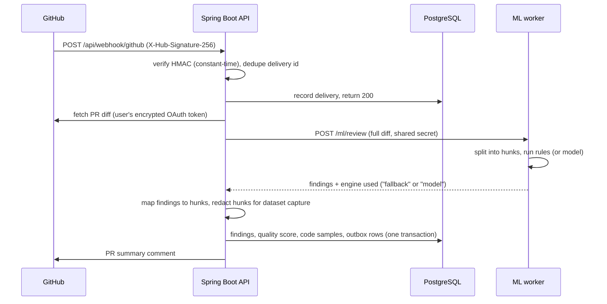

# Automated Code Review Tool

A self-hostable pull-request reviewer. It receives GitHub webhooks, parses each
PR diff into hunks, runs anti-pattern detection over the added lines, stores
findings and a quality score, and posts a summary comment back on the PR. The
same detection is available from a VS Code extension and a GitHub Action.

> **Detection status:** the detector that runs by default is a deterministic,
> rule-based scanner (`MODEL_NAME=none`). The repo also contains a CodeBERT
> multi-label training and serving pipeline. No trained checkpoint or labelled
> dataset is shipped, and no model accuracy figures are claimed.

## Architecture

```mermaid
flowchart LR
    GH[GitHub webhook] --> API
    ACT[GitHub Action] --> API
    EXT[VS Code extension] --> API
    WEB[Next.js dashboard] --> API
    subgraph API[Spring Boot API &#40;Java 21&#41;]
      direction TB
      SEC[JWT / API-key auth, rate limit, HMAC verify]
      REV[ReviewService: diff to hunks, quality score]
      OUT[Outbox processor]
    end
    API --> PG[(PostgreSQL 16 + Flyway)]
    API --> RD[(Redis: token blacklist, rate limits)]
    API -->|POST /ml/review, shared secret| ML[FastAPI ML worker]
    ML --> RULES[Rule-based scanner]
    ML -.optional checkpoint.-> BERT[CodeBERT classifier]
```



| Component | Path | Stack |
| --- | --- | --- |
| API / control plane | `apps/api` | Java 21, Spring Boot 3, Spring Security, JPA, Flyway, Resilience4j, Redis |
| ML worker | `apps/ml-worker` | Python 3.11, FastAPI, Pydantic; PyTorch/Transformers loaded only when a checkpoint is configured |
| Dashboard | `apps/web` | Next.js (App Router), TypeScript, Tailwind, Recharts |
| VS Code extension | `apps/vscode-ext` | TypeScript, VS Code API |
| GitHub Action | `github-action` | Node 20, `@actions/core`, Octokit, bundled with ncc |
| Anti-pattern taxonomy | `taxonomy/anti_patterns.yaml` | Single source of truth for finding IDs |
| Cross-language fixtures | `contracts/` | JSON cases shared by Java and Python tests |

## How a PR review flows



## Taxonomy

Finding IDs come from `taxonomy/anti_patterns.yaml`. The Python worker loads
the file directly. A Flyway migration seeds the same IDs into the API's
`anti_patterns` table, a test checks that they match, and the API refuses to
start if the table is empty.

| Category | IDs |
| --- | --- |
| Security | `SECURITY_HARDCODED_SECRET`, `SECURITY_SQL_INJECTION`, `SECURITY_WEAK_CRYPTO` |
| Performance | `PERFORMANCE_N_PLUS_ONE`, `PERFORMANCE_QUADRATIC_LOOP` |
| Reliability | `RELIABILITY_BROAD_EXCEPTION`, `RELIABILITY_MISSING_TIMEOUT`\* |
| Readability | `READABILITY_MAGIC_NUMBER`, `READABILITY_LONG_METHOD` |
| Maintainability | `MAINTAINABILITY_DUPLICATE_CODE`\*, `MAINTAINABILITY_COMMENTED_CODE`, `MAINTAINABILITY_PRINT_STATEMENT` |

\* Model-only labels. The rule scanner has no rule for them, so the default
deployment never reports them.

The rule scanner handles Python, JavaScript/TypeScript and Java. Other files in
a PR diff (Markdown, config, etc.) are skipped.

## API surface

| Method | Path | Auth |
| --- | --- | --- |
| GET | `/api/auth/github`, `/api/auth/callback` | GitHub OAuth (state-checked) |
| GET | `/api/auth/me` | JWT cookie |
| POST | `/api/auth/refresh`, `/api/auth/logout` | refresh cookie / JWT |
| GET/POST/DELETE | `/api/auth/api-keys[/{id}]` | JWT |
| GET/POST/DELETE | `/api/repos`, `/api/repos/connect`, `/api/repos/{id}` | JWT, owner-scoped |
| GET | `/api/repos/{id}/prs` | JWT, owner-scoped, paginated |
| GET | `/api/reviews/{prId}` | JWT, owner-scoped |
| GET | `/api/metrics/quality-trend?repo=&days=` | JWT, owner-scoped |
| POST | `/api/scan/file` | API key (`Authorization: Bearer <key>`) or JWT |
| POST | `/api/scan/action` | JWT (accept/dismiss a finding) |
| POST | `/api/webhook/github` | HMAC-SHA256 signature |

## Design decisions worth discussing

- **Two services, one owner of state.** Only the Java API touches PostgreSQL
  and GitHub. The ML worker is stateless and reachable only with a shared
  secret, so it can be scaled or swapped (rules ↔ model) without touching
  persistence.
- **Honest degradation.** If no checkpoint is configured, or the configured one
  fails validation, the worker serves the rule engine and reports
  `engine: "fallback"` in every response and in `/ml/health`.
- **Webhook safety.** The HMAC is computed over the raw request bytes and
  compared in constant time. Deliveries are deduplicated by `X-GitHub-Delivery`
  and processed asynchronously, so GitHub gets a fast 2xx and retries are
  idempotent. A diff the worker rejects (4xx) is marked failed immediately
  instead of being retried.
- **Explicit Redis-outage policy.** Auth paths fail closed: if the token
  blacklist can't be checked, the API returns 503 rather than accepting a
  possibly revoked token. Rate limiters fail open and log a warning.
- **Secrets handling.** GitHub OAuth tokens and webhook secrets are encrypted at
  rest (AES-256-GCM), and API keys are stored as bcrypt hashes. Hunks are
  passed through a secret redactor before they're written to the dataset tables.
  The worker gets raw code, because detecting hard-coded secrets needs it.
- **Transactional outbox.** Findings, code samples and outbox rows are written
  in one transaction. A scheduled processor claims outbox rows with
  `SELECT … FOR UPDATE SKIP LOCKED` and a lease, so a crash can't lose an event.
  Delivery is at-least-once, and handlers are idempotent.
- **Taxonomy as a contract.** One YAML file defines finding IDs for the rule
  scanner, the model label order, and the database `anti_patterns` table.
  Cross-language JSON fixtures in `contracts/` pin the quality-score formula
  and hunk identity hashing for the Java, Python and Action implementations.
- **Clients that respect the same contract.** The GitHub Action scans each
  changed file at the PR head and annotates only findings on added lines. The
  VS Code extension keeps its API key in VS Code SecretStorage. The dashboard
  lets reviewers accept, dismiss or mark a finding fixed. External PR links
  allow only HTTPS `github.com` pull-request URLs without embedded credentials;
  script URLs and lookalike domains are not rendered as links.

### Security verification

Run full `npm audit` in each Node package and `pip-audit` against the worker
requirements, including training dependencies. Dependency scans do not prove
that an application is vulnerability-free.

The Maven runtime graph was checked against OSV. Three Spring Framework
advisories still apply at the package-version level:
[SSE view fragments](https://osv.dev/vulnerability/GHSA-j9f9-w8pj-32f8),
[XSLT views](https://osv.dev/vulnerability/GHSA-pc63-qcmh-9cmg) and
[functional WebFlux routes](https://osv.dev/vulnerability/GHSA-9qf2-26p9-2q2q).
This API uses none of those features; no findings are suppressed. Reassess
these advisories before adding view rendering, SSE or functional routes.

## Running locally

Requirements: Docker with Compose v2. For running services outside Docker you
also need JDK 21 + Maven 3.9, Python 3.11, and Node 20+.

```bash
git clone https://github.com/tanmay-alpha/automated-code-review-tool.git
cd automated-code-review-tool
cp .env.example .env     # set GITHUB_CLIENT_ID / GITHUB_CLIENT_SECRET for OAuth login
docker compose --env-file .env -f infra/docker-compose.yml up --build
```

- Dashboard: <http://localhost:3000>
- API health: <http://localhost:8080/actuator/health>
- ML worker health: <http://localhost:8000/ml/health>

Compose publishes ports on `127.0.0.1` only: its example database passwords,
JWT signing key and worker secret are development values, not deployment
credentials. Replace them before deploying; expose only the dashboard/API
through your HTTPS ingress, not PostgreSQL, Redis or the worker.

Try the worker on its own (the default secret from `.env.example`):

```bash
curl -s localhost:8000/ml/review \
  -H 'content-type: application/json' \
  -H 'x-ml-worker-secret: local-ml-worker-secret-change-me' \
  -d '{"mode":"diff","language":"python","diff":"diff --git a/app.py b/app.py\n--- a/app.py\n+++ b/app.py\n@@ -0,0 +1,5 @@\n+password = \"hunter2hunter2hunter2\"\n+try:\n+    run()\n+except:\n+    pass"}'
```

## Tests

Each component has its own CI workflow in `.github/workflows/`.

```bash
# API: unit + slice tests on H2; PostgreSQL Testcontainers suite needs Docker
cd apps/api && mvn -B -ntp test && mvn -B -ntp -Ppostgres-correctness test

# ML worker
cd apps/ml-worker && ruff check app training tests && mypy app training && pytest -q

# Dashboard
cd apps/web && npm ci && npx tsc --noEmit && npm test && npm run build

# GitHub Action (dist/ must match a fresh build)
cd github-action && npm ci && npm test && npm run build && git diff --exit-code -- dist

# VS Code extension
cd apps/vscode-ext && npm ci && npm run compile && npm test
```

## Deployment

`render.yaml` is a Render blueprint for PostgreSQL, Redis, the ML worker, the
API, and the dashboard. CI validates it against Render's published schema. The
ML worker is deployed in fallback mode (`MODEL_NAME=none`).

## Known limitations

- No trained model is shipped. Model promotion requires a labelled dataset and
  an evaluation run that this repository doesn't include.
- The rule engine is regex- and heuristic-based, so it trades recall for
  predictability and can't reason across files.
- GitHub integration uses an OAuth app and per-repo webhooks, not a GitHub App.

## License

[MIT](LICENSE) © 2026 Tanmay Mangal
