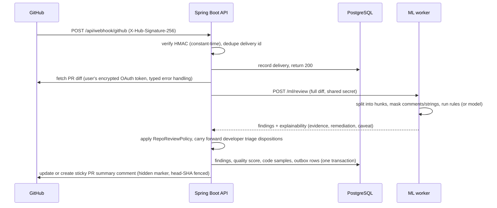

# Automated Code Review Tool

A self-hostable pull-request reviewer. It receives GitHub webhooks, parses each
PR diff into hunks, runs anti-pattern detection over the added lines, stores
findings and a quality score, and posts a summary comment back on the PR. The
same detection is available from a VS Code extension and a GitHub Action.

> **Detection status:** the detector that runs by default is a deterministic,
> rule-based scanner (`MODEL_NAME=none`, reporting `modelVersion: rule-baseline-v2`).
> The repository also contains a CodeBERT multi-label training and serving pipeline.
> No trained checkpoint or labelled dataset is shipped, and no model accuracy figures
> are claimed.
>
> On a benchmark of 21 synthetic PR-level diffs (`benchmarks/run_benchmark.py`),
> the rule engine achieves held-out **Precision 0.933, Recall 0.875, and F1 0.903**
> across 8 held-out PRs (14 TP, 1 FP, 2 FN). *Limitations:* 21 PRs and 40 supported
> findings; per-antiPattern rows have one to four positives, so one fixture moves a
> row from 0 to 1. Treat the numbers as regression signals for these rules, not as an
> estimate of precision on real pull requests. Full benchmark methodology, splits,
> and confusion matrices are documented in [docs/review-benchmark.md](docs/review-benchmark.md).

## Architecture

```mermaid
flowchart LR
    GH[GitHub webhook] --> API
    ACT[GitHub Action] --> WEB
    EXT[VS Code extension] --> WEB
    BROWSER[Browser] --> WEB
    subgraph WEB[Next.js Dashboard &#40;Node 24&#41;]
      direction TB
      PROXY[Runtime proxy /api/* &#8594; API_INTERNAL_URL]
      UI[App Router UI, Radix modals, Recharts]
    end
    WEB -->|Same-origin /api/*| API
    subgraph API[Spring Boot API &#40;Java 21&#41;]
      direction TB
      SEC[OriginVerificationFilter, JWT ver, AES-256-GCM]
      REV[ReviewService: diff to hunks, quality score, triage carry-forward]
      OUT[Outbox processor, attempt fencing, sticky comments]
    end
    API --> PG[(PostgreSQL 16 + Flyway)]
    API --> RD[(Redis: token blacklist, rate limits)]
    API -->|POST /ml/review, shared secret| ML[FastAPI ML worker &#40;Python 3.11&#41;]
    ML --> RULES[Rule scanner: lexical masking, guidance]
    ML -.optional checkpoint.-> BERT[CodeBERT classifier]
```



| Component | Path | Stack |
| --- | --- | --- |
| API / control plane | `apps/api` | Java 21, Spring Boot 3, Spring Security, JPA, Flyway, Resilience4j, Redis |
| ML worker | `apps/ml-worker` | Python 3.11, FastAPI, Pydantic; PyTorch/Transformers loaded only when a checkpoint is configured |
| Dashboard | `apps/web` | Next.js 14 (App Router), TypeScript, Tailwind, Radix UI, Recharts |
| VS Code extension | `apps/vscode-ext` | TypeScript, VS Code API |
| GitHub Action | `github-action` | Node 24, `@actions/core`, Octokit, bundled with ncc |
| Anti-pattern taxonomy | `taxonomy/anti_patterns.yaml` | Single source of truth for finding IDs |
| Cross-language fixtures | `contracts/` | JSON cases shared by Java and Python tests |

## How a PR review flows



## Taxonomy

Finding IDs come from `taxonomy/anti_patterns.yaml`. The Python worker loads
the file directly. A Flyway migration seeds the same IDs into the API's
`anti_patterns` table, a test checks that they match, and the API refuses to
start if the table is empty.

| Category | IDs |
| --- | --- |
| Security | `SECURITY_HARDCODED_SECRET`, `SECURITY_SQL_INJECTION`, `SECURITY_WEAK_CRYPTO` |
| Performance | `PERFORMANCE_N_PLUS_ONE`, `PERFORMANCE_QUADRATIC_LOOP` |
| Reliability | `RELIABILITY_BROAD_EXCEPTION`, `RELIABILITY_MISSING_TIMEOUT` |
| Readability | `READABILITY_MAGIC_NUMBER`, `READABILITY_LONG_METHOD` |
| Maintainability | `MAINTAINABILITY_DUPLICATE_CODE`\*, `MAINTAINABILITY_COMMENTED_CODE`, `MAINTAINABILITY_PRINT_STATEMENT` |

\* Model-only label. The rule scanner has no rule for `MAINTAINABILITY_DUPLICATE_CODE`,
so the default deployment never reports it. `RELIABILITY_MISSING_TIMEOUT` is rule-supported
across Python (`requests`, `urlopen`), JavaScript/TypeScript (`fetch`, `axios`),
and Java (`HttpClient`).

The rule scanner handles Python, JavaScript/TypeScript, and Java. Other files in
a PR diff (Markdown, config, etc.) are skipped.

## API surface

| Method | Path | Auth |
| --- | --- | --- |
| GET | `/api/auth/github`, `/api/auth/callback` | GitHub OAuth (state-checked, redirects with `?authError=<code>` on failure) |
| GET | `/api/auth/me` | JWT cookie (`__Host-accessToken` in production) |
| POST | `/api/auth/refresh`, `/api/auth/logout` | refresh cookie (`__Host-refreshToken`) / JWT |
| POST | `/api/auth/logout-all` | JWT (invalidates all active access and refresh tokens across all devices via user token version) |
| GET/POST/DELETE | `/api/auth/api-keys[/{id}]` | JWT |
| GET/POST/DELETE | `/api/repos`, `/api/repos/connect`, `/api/repos/{id}` | JWT, owner-scoped |
| GET | `/api/repos/{id}/prs` | JWT, owner-scoped, paginated (`repo_id, created_at DESC` indexed) |
| GET/PUT | `/api/repos/{id}/settings` | JWT, owner-scoped (enabled rules, min severity/confidence, comment flags, languages) |
| GET | `/api/reviews/{prId}` | JWT, owner-scoped |
| GET | `/api/reviews/{prId}/runs` | JWT, owner-scoped (newest-first review delivery and publication history, max 50) |
| GET | `/api/metrics/quality-trend?repo=&days=` | JWT, owner-scoped |
| GET | `/api/metrics/finding-summary?repo=&days=` | JWT, owner-scoped (triage outcome per rule, findings per engine) |
| GET | `/api/diagnostics` | JWT (parallel dependency health: DB, Redis, ML worker, GitHub; owner-scoped queue depth) |
| POST | `/api/scan/file` | API key (`Authorization: Bearer <key>`) or JWT |
| POST | `/api/scan/action` | JWT, owner-scoped (`accept`/`dismiss`/`fix`/`false_positive`/`reopen`; `reason` required for dismiss and false_positive) |
| POST | `/api/webhook/github` | HMAC-SHA256 signature (`X-Hub-Signature-256`) |

## Design decisions worth discussing

- **Two services, one owner of state.** Only the Java API touches PostgreSQL
  and GitHub. The ML worker is stateless and reachable only with a shared
  secret, so it can be scaled or swapped (rules ↔ model) without touching
  persistence.
- **Origin verification (CSRF).** An explicit `OriginVerificationFilter` runs
  before Spring's CORS processor. Cookie-authenticated mutating requests
  (POST, PUT, PATCH, DELETE) require an `Origin` matching `ALLOWED_ORIGINS`
  (defaulting to `FRONTEND_URL`), or `Sec-Fetch-Site: same-origin`, or a
  matching `Referer` if `Origin` is omitted. Requests without ambient session
  cookies (Bearer tokens, API keys, HMAC webhooks) are exempt.
- **Sticky comment with marker and head-SHA fencing.** Review comments on
  pull requests maintain exactly one sticky summary comment using a hidden
  author-scoped HTML marker. Subsequent pushes edit the existing comment via
  `PATCH` rather than posting duplicate comments. Competing workers lease
  publication attempts, and both database and GitHub head SHAs are re-verified
  immediately before external writes to prevent publishing stale findings if
  a new commit arrives during analysis.
- **Typed GitHub errors.** `GitHubApiException` classifies upstream HTTP and
  transport failures. Revoked credentials, 404s, and oversized diffs are
  classified as terminal and dead-lettered immediately with clear reasons.
  Network drops, 5xx server errors, and rate limits are classified as transient,
  backing off to upstream `Retry-After` or rate-limit reset headers (capped at 1 hr).
- **Repository review settings applied before persistence.** Per-repository
  settings (`RepoReviewPolicy`) configure enabled rules, minimum severity,
  confidence thresholds, and publication flags (`postComments`, `inlineComments`).
  Settings are validated against the taxonomy and applied before findings are
  persisted or published.
- **Triage carry-forward.** Developer triage dispositions (`dismissed`,
  `false_positive` with reasons, `triagedBy`, and `triagedAt`) are carried
  forward across subsequent commits on unchanged code by matching
  `(filePath, antiPattern, SHA-256 evidenceHash)`. Dismissed and false-positive
  findings are automatically suppressed from GitHub PR comments.
- **Honest degradation.** If no checkpoint is configured, or the configured one
  fails validation, the worker serves the rule engine and reports
  `engine: "fallback"` in every response and in `/ml/health`.
- **Webhook safety.** The HMAC is computed over the raw request bytes and
  compared in constant time. Deliveries are deduplicated by `X-GitHub-Delivery`
  and processed asynchronously, so GitHub gets a fast 2xx and retries are
  idempotent. A diff the worker rejects (4xx) is marked failed immediately
  instead of being retried.
- **Explicit Redis-outage policy.** Auth paths fail closed: if the token
  blacklist can't be checked, the API returns 503 rather than accepting a
  possibly revoked token. Rate limiters fail open and log a warning.
- **Secrets handling.** GitHub OAuth tokens and webhook secrets are encrypted at
  rest (AES-256-GCM), and API keys are stored as bcrypt hashes. Hunks are
  passed through a secret redactor before they're written to dataset tables.
  The worker gets raw code, because detecting hard-coded secrets needs it.
- **Transactional outbox.** Findings, code samples and outbox rows are written
  in one transaction. A scheduled processor claims outbox rows with
  `SELECT … FOR UPDATE SKIP LOCKED` and a lease, so a crash can't lose an event.
  Delivery is at-least-once, and handlers are idempotent.
- **Taxonomy as a contract.** One YAML file defines finding IDs for the rule
  scanner, the model label order, and the database `anti_patterns` table.
  Cross-language JSON fixtures in `contracts/` pin the quality-score formula
  and hunk identity hashing for the Java, Python and Action implementations.
- **Clients that respect the same contract.** The GitHub Action scans each
  changed file at the PR head and annotates only findings on added lines. The
  VS Code extension keeps its API key in VS Code SecretStorage and sends
  workspace-relative paths. The dashboard lets reviewers accept, dismiss, reopen,
  or mark a finding fixed or false positive with mandatory audit reasons.

### Security verification

Run full `npm audit` in each Node package and `pip-audit` against the worker
requirements, including training dependencies. Dependency scans do not prove
that an application is vulnerability-free.

The Maven runtime graph was checked against OSV. Three Spring Framework
advisories still apply at the package-version level:
[SSE view fragments](https://osv.dev/vulnerability/GHSA-j9f9-w8pj-32f8),
[XSLT views](https://osv.dev/vulnerability/GHSA-pc63-qcmh-9cmg) and
[functional WebFlux routes](https://osv.dev/vulnerability/GHSA-9qf2-26p9-2q2q).
This API uses none of those features; no findings are suppressed. Reassess
these advisories before adding view rendering, SSE or functional routes.

Detailed application security analysis, threat boundaries, and ASVS 5.0 audit
results are documented in [docs/security-review.md](docs/security-review.md).

## Running locally

Requirements: Docker with Compose v2. For running services outside Docker you
also need JDK 21 + Maven 3.9, Python 3.11, and Node 24.

```bash
git clone https://github.com/tanmay-alpha/automated-code-review-tool.git
cd automated-code-review-tool
cp .env.example .env     # set GITHUB_CLIENT_ID / GITHUB_CLIENT_SECRET for OAuth login
docker compose --env-file .env -f infra/docker-compose.yml up --build
```

- Dashboard: <http://localhost:3000>
- API health: <http://localhost:8080/actuator/health>
- ML worker health: <http://localhost:8000/ml/health>

Compose publishes ports on `127.0.0.1` only: its example database passwords,
JWT signing key and worker secret are development values, not deployment
credentials. Replace them before deploying; expose only the dashboard/API
through your HTTPS ingress, not PostgreSQL, Redis or the worker.

Try the worker on its own (the default secret from `.env.example`):

```bash
curl -s localhost:8000/ml/review \
  -H 'content-type: application/json' \
  -H 'x-ml-worker-secret: local-ml-worker-secret-change-me' \
  -d '{"mode":"diff","language":"python","diff":"diff --git a/app.py b/app.py\n--- a/app.py\n+++ b/app.py\n@@ -0,0 +1,5 @@\n+password = \"hunter2hunter2hunter2\"\n+try:\n+    run()\n+except:\n+    pass"}'
```

## Tests

Each component has its own CI workflow in `.github/workflows/`.
Each can also be run explicitly from GitHub's Actions tab or with
`gh workflow run ci-api.yml --ref main` (replace the filename for another component).

```bash
# API: unit + slice tests on H2; PostgreSQL Testcontainers suite needs Docker
cd apps/api && mvn -B -ntp test && mvn -B -ntp -Ppostgres-correctness test

# ML worker: lint, static types, unit tests, and evaluation benchmark
cd apps/ml-worker && ruff check app training tests && mypy app training && pytest -q
python benchmarks/run_benchmark.py

# Dashboard: unit tests, build, and Playwright E2E with axe accessibility checks
cd apps/web && npm ci && npx tsc --noEmit && npm test && npm run build
npx playwright install chromium && npm run test:e2e

# GitHub Action: unit tests, Node 24 runtime, and dist/ integrity check
cd github-action && npm ci && npm test && npm run build && git diff --exit-code -- dist

# VS Code extension: lint, compilation, and unit tests
cd apps/vscode-ext && npm ci && npm run compile && npm test

# End-to-end integration test against live/mocked GitHub API
python scripts/e2e/run_github_e2e.py
```

## Deployment

`render.yaml` is a Render blueprint for PostgreSQL, Redis, the ML worker, the
Spring Boot API, and the Next.js dashboard. CI validates it against Render's published schema.

- **Same-origin Next proxy (`API_INTERNAL_URL`):** The browser interacts solely
  with the dashboard origin. The Next.js runtime proxy (`app/api/[...path]/route.ts`)
  relays `/api/*` requests to the internal API host (`API_INTERNAL_URL`), preserving
  cookies, `Origin`, and client headers. This avoids cross-site cookie restrictions
  on multi-host deployments (e.g. `onrender.com`).
- **OAuth callback:** Configured as `<web origin>/api/auth/callback`, with
  `FRONTEND_URL` and `APP_BASE_URL` pointing to the web origin.
- **Secure session cookies:** In production with `COOKIE_SECURE=true`, cookies use
  the `__Host-` prefix (`__Host-accessToken`, `__Host-refreshToken`, `__Host-oauth_state`)
  with `Path=/; Secure; SameSite=Lax`. Local development with `COOKIE_SECURE=false`
  falls back to plain cookie names over plain HTTP.
- **Public webhook ingress:** GitHub webhooks target the API's public URL
  (`WEBHOOK_CALLBACK_URL`), bypassing the web dashboard.
- **Fallback ML mode:** The ML worker runs in deterministic rule mode (`MODEL_NAME=none`).

## Documentation

- [Engineering Audit & Findings Tracker](docs/engineering-audit.md) — Comprehensive hardening audit and consolidated defect tracker.
- [Application Security Review](docs/security-review.md) — Threat model, CSRF/origin analysis, session controls, and ASVS 5.0 audit.
- [Review Benchmark Methodology & Results](docs/review-benchmark.md) — PR-level benchmark harness, 21 fixtures, metrics, and confusion matrices.
- [Production Release Checklist](docs/release-checklist.md) — Source gates, environment configs, deployment verifications, and rollback steps.
- [Product & Engineering Roadmap](docs/roadmap.md) — Deferred items, GitHub App migration, Tree-sitter AST, and future milestones.
- [ML System Design & Training](docs/ml-system-design.md) — ML worker architecture, CodeBERT training pipelines, and promotion gates.

## Known limitations

- No trained model is shipped. Model promotion requires a labelled dataset and
  an evaluation run that this repository doesn't include.
- The rule engine is regex- and heuristic-based, so it trades recall for
  predictability and can't reason across files or complex AST scopes.
- GitHub integration currently uses an OAuth app and per-repo webhooks rather
  than a GitHub App (see [Roadmap](docs/roadmap.md)).

## License

[MIT](LICENSE) © 2026 Tanmay Mangal
